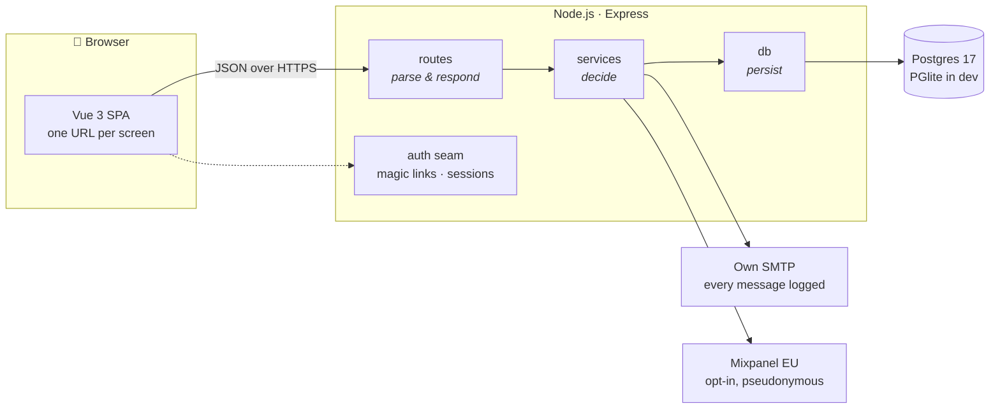
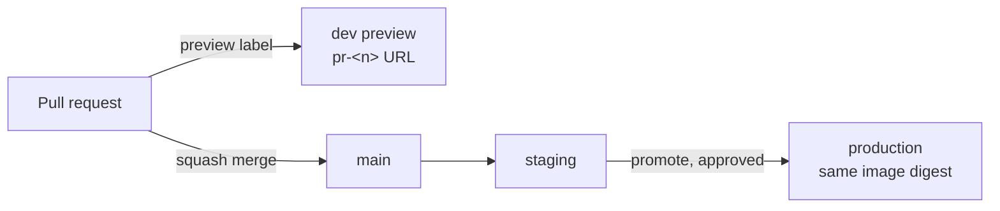

<div align="center">

# Rebel Match

**Find the peers who face your challenge — or have already solved it.**

Peer matching for the [Corporate Rebels](https://www.corporate-rebels.com)
network. Bring an organizational challenge, get matched in a conference break.

[](https://github.com/wrych/rebel-match/actions/workflows/ci.yml)
[](LICENSE)


[](https://www.conventionalcommits.org)

[What it does](#what-it-does) · [How it works](#how-it-works) ·
[Quick start](#quick-start) · [Contributing](#contributing) ·
[Authors](#authors) · [License](#license)

</div>

---

## What it does

Members of the Corporate Rebels network sign in with a magic link, write a
challenge from their own organization in their own words, and are matched with:

|     |                  |                                                    |
| --- | ---------------- | -------------------------------------------------- |
| 🚣  | **Same boat**    | peers who face the same thing right now            |
| 🧭  | **Been there**   | peers who have solved it and can share experience  |
| 📚  | **Case studies** | curated stories from organizations that changed it |

Each challenge is placed in one of the **8 Corporate Rebels trends** — from
_Profit_ to _Purpose & Values_, from _Hierarchical Pyramid_ to _Network of
Teams_ — and the author can correct the pick.

Two doors open after sign-in:

- **Ask for help** — post a challenge and see who matches.
- **Offer help** — swipe through other members' challenges and flag "same boat"
  or "I can share experience".

**Privacy comes first.** Connecting is a **double opt-in**: the other person is
asked, and only when both agree are email addresses exchanged. No contact detail is
ever readable without an accepted connection, and analytics are opt-in and see
only pseudonymous ids.

The beta launches at the Corporate Rebels summit on **2026-11-08**, where
attendees scan a QR code on their phone and must get from scan to onboarded in
**under two minutes**.

<details>
<summary><b>And a little more</b></summary>

- A **matches cockpit** for pending requests, connections and activity.
- **Follow a trend** and get notified when new challenges arrive.
- **Private badges** counted from what a member does.
- **Invite links** as QR codes that admit attendees straight away.
- **Host tools**: applicant approval, invite links, moderation of reported
  content, GDPR erasure and an outbound message log.
- **Happy mode** — a colour mode that, for the curious, hides
  _9toRevolution_, an office game. Turn your phone. 🕹️

</details>

## How it works



| Layer         | Choice                                                                                               |
| ------------- | ---------------------------------------------------------------------------------------------------- |
| **Client**    | Vue 3 SPA with Vite and vue-router; mobile-first; screens, not modals; routes shared with the server |
| **Server**    | Node.js and Express 5, TypeScript strict, Zod at the boundary                                        |
| **Data**      | Postgres 17 through Drizzle; [PGlite](https://pglite.dev) in process for development and tests       |
| **Auth**      | Passwordless magic links over an invite-only whitelist, behind one narrow seam                       |
| **Access**    | Role-based, checked by permission — never by role name                                               |
| **Matching**  | Keyword trend detection behind an interface, so a smarter matcher can replace it later               |
| **Mail**      | The team's own SMTP server; every message recorded in an outbound log, nothing sent in development   |
| **Analytics** | Mixpanel with EU residency, opt-in, sent from the server, pseudonymous ids only                      |
| **Hosting**   | Google Cloud Run in Zurich; dev previews, staging and production deploy from GitHub                  |

The design keeps a **pure core with I/O at the edges**: services receive their
dependencies as arguments, so the critical modules — the trend matcher,
magic-link tokens, the permission resolver, the double opt-in rules — are
unit-tested without a database.

### From pull request to production



Dev and staging hold only fictional people and send no mail. Production never
builds; it runs the exact image staging ran.

## Quick start

You need **Node.js 24** (see [`.nvmrc`](.nvmrc)). No `.env` and no database
server are required.

```sh
git clone https://github.com/wrych/rebel-match.git
cd rebel-match
npm ci
npm run dev
```

`npm run dev` migrates and seeds a local database, prints a sign-in link for
the dev admin, and starts the API on **:3000** and the client on
**[localhost:5173](http://localhost:5173)**.

Without `DATABASE_URL` the app runs on PGlite in `.data/pglite` and generates
its session secret once. Copy [`.env.example`](.env.example) to `.env` only to
change something; `npm run db:up` starts a real Postgres in Docker. In
development no mail is sent — magic links wait for you in the outbound log at
`/admin/outbox`.

### Commands

| Command                     | What it does                                                    |
| --------------------------- | --------------------------------------------------------------- |
| `npm run dev`               | migrate, seed, then run server and client with reload           |
| `npm test`                  | unit tests with coverage (Vitest)                               |
| `npm run test:integration`  | API tests on Postgres, or in-memory PGlite                      |
| `npm run lint`              | ESLint and Prettier                                             |
| `npm run typecheck`         | `tsc` and `vue-tsc`                                             |
| `npm run dev:login [email]` | a sign-in link for a seeded member (server stopped)             |
| `npm run db:reset`          | rebuild the local PGlite database from the migrations           |
| `npm run review`            | the reviewer agent on your branch, as the pre-push hook runs it |
| `npm run build` / `start`   | production build and server                                     |

The full list is in [`AGENTS.md`](AGENTS.md#commands).

## Repository map

```
specs/          the product spec — what must be true; read before coding
  requirements.md   numbered requirements (R-*), in EARS phrasing
  flows.md          every user journey end to end
  design.md         architecture, schema, API, screens, matcher, seeds
  tasks.md          milestones, each task citing its requirement
docs/
  constitution.md   the engineering rules every change obeys
  adr/              architecture decision records — why it is like this
  legal/            privacy notice and terms of use
src/            server: routes, services, auth seam, db, migrations, seeds
client/         Vue SPA: screens, components, and the game
tests/          API integration tests
```

## Contributing

Rebel Match is **spec-driven**. Every change serves a numbered requirement in
[`specs/requirements.md`](specs/requirements.md), and every major decision is
recorded as an [ADR](docs/adr/README.md) before the code is written.

1. **Find the requirement** (`R-*`). If none covers your change, the spec
   changes first, in its own commit.
2. **Check for a decision** in [`docs/adr/`](docs/adr/README.md). A major one
   not yet made gets an ADR — copy the [template](docs/adr/template.md).
3. **Branch** from `main` as `type/short-topic`, e.g. `feat/follow-trend`.
4. **Write the tests with the change**, in the same commit.
5. **Commit** with [Conventional Commits](https://www.conventionalcommits.org):
   `type(scope): subject`, one concern per commit.
6. **Open a pull request** citing the requirement and any ADR. It is
   squash-merged once CI's `check` and `build` are green.

Hooks keep the loop short: **pre-commit** formats, lints and typechecks,
**commit-msg** checks the message, and **pre-push** runs the tests and a
reviewer agent that blocks on privacy, security, correctness and spec
contradictions.

> [!IMPORTANT]
> Six things get a change rejected outright: a behavior change without tests;
> a role name in a conditional instead of a permission check; personal data in
> a log, error or analytics event; a contact detail readable without an
> accepted connection; a comment explaining what the code does; and a magic
> number where a config value belongs.

Read these before your first change — both are short on purpose:

- 📘 [`AGENTS.md`](AGENTS.md) — how to work in this repository, for people and
  agents alike
- ⚖️ [`docs/constitution.md`](docs/constitution.md) — the rules, citable in
  review

## Authors

<table>
  <tr>
    <td align="center" width="200">
      <br>
      <b>Pascal Dulex</b><br>
      <sub>Idea · Design · Community</sub>
    </td>
    <td align="center" width="200">
      <br>
      <b>Andy Moesch</b><br>
      <sub>Engineering</sub>
    </td>
    <td align="center" width="200">
      <br>
      <b>Ivo Pejakovic</b><br>
      <sub>User Experience · Testing</sub>
    </td>
  </tr>
</table>

…and the **Rebel Match contributors** and the Corporate Rebels community, who
bring the challenges, the experience and the connections.

## License

Released under the [MIT License](LICENSE) — © 2026 Pascal Dulex, Ivo Pejakovic,
Andy Moesch and the Rebel Match contributors. Contributions are accepted under
the same license; see [ADR 0042](docs/adr/0042-mit-license.md) for why.
Third-party assets keep their own licenses, such as the fonts under OFL-1.1.

The app's own [privacy notice](docs/legal/privacy-notice.md) and
[terms of use](docs/legal/terms-of-use.md) live in `docs/legal/`.
